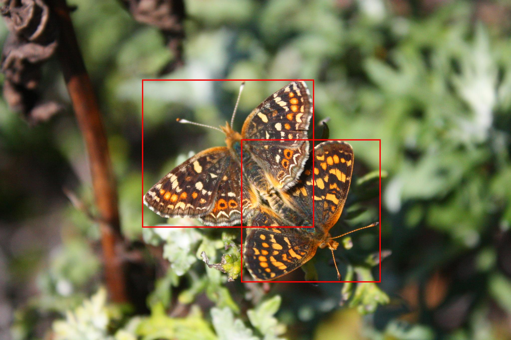
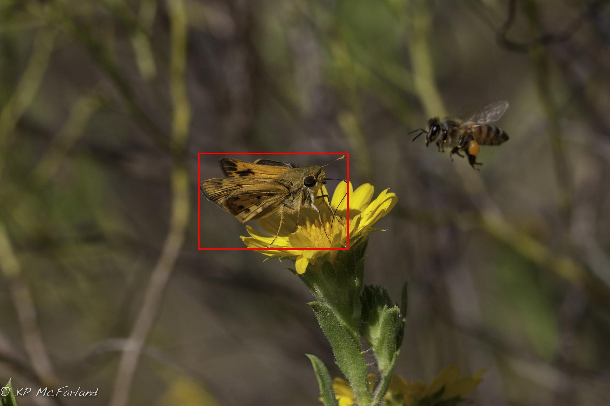
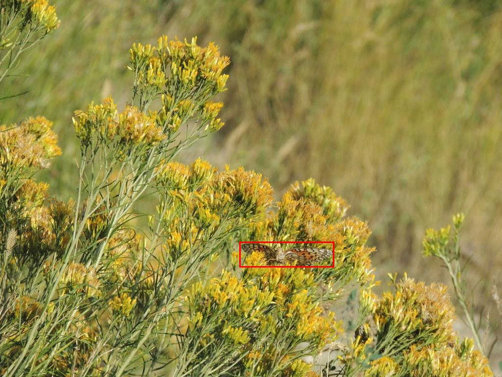
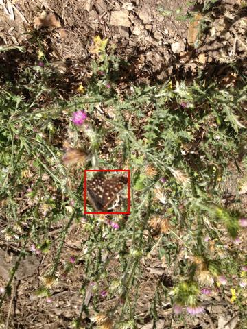

# ysda-crowdsourcing-final-project

## Оценка моделей

Для оценки модели использовался размеченный [Golden Set](data/golden_set.json) из 400 картинок.
Воспроизвести результаты оценки можно при помощи следующих команд:

```shell
uv run materialize -i path/to/golden_set.json
uv run evaluate -i path/to/golden_set.json -m [dino|owl|qwen]
uv run recover-evaluation data/evaluations/qwen_manual_prompt.csv data/evaluations/qwen_manual_prompt.responses.jsonl data/evaluations/qwen_manual_prompt_recovered.csv
```

Для Dino и Owl можно задать порог предсказания и таргеты.
Для Квен можно указать файл с промтом.

Скрипт recover-evaluation нужен, потому что Qwen не всегда справляется с выдачей правильно отформатированного JSON, но часто его можно восстановить из ответа.

## Сравнение моделей

Таблица содержит часть проведенных для оценки моделей экспериментов.
Для Dino и Owl подбирались формулировки таргетов и порог предсказания.
Для Qwen подбирался промпт.
Замеры времени производились на MacBook M4 Pro 48 GB.

| Модель / конфигурация | Порог уверенности | Успешных изображений | Precision | Recall | F1 | Mean matched IoU | Среднее время, с/изображение |
|---|---:|---:|---:|---:|---:|---:|---:|
| DINO — butterfly + moth | 0.10 | 400/400 | 14.4% | 89.4% | 24.8% | 0.889 | 0.72 |
| DINO — только butterfly | 0.15 | 400/400 | 62.9% | 67.1% | 65.0% | 0.874 | 0.37 |
| DINO — только butterfly | 0.30 | 400/400 | 100.0% | 1.1% | 2.1% | 0.976 | 0.37 |
| DINO — описательные метки | 0.30 | 400/400 | 40.0% | 4.2% | 7.7% | 0.928 | 1.83 |
| OWLv2 — butterfly + moth | 0.10 | 400/400 | 8.4% | **97.2%** | 15.5% | 0.835 | 0.53 |
| OWLv2 — только butterfly | 0.30 | 400/400 | 70.2% | 88.3% | 78.2% | 0.827 | 0.27 |
| **OWLv2 — только butterfly** | **0.40** | **400/400** | **83.5%** | **82.3%** | **82.9%** | 0.824 | **0.27** |
| Qwen — промпт v0.1 | — | 400/400 | 67.6% | 88.3% | 76.6% | 0.883 | 5.67 |
| Qwen — промпт v0.2 | — | 399/400 | 80.1% | 93.6% | 86.3% | 0.883 | 6.00 |
| **Qwen — промпт v1.0** | — | **399/400** | **91.6%** | **92.9%** | **92.3%** | **0.885** | 6.29 |

Поскольку качество в данном случае важнее скорости работы, финальные предсказания, отправленные в контест, это Qwen с [версией промта 1.0](src/project/prompts/qwen.md) (это только содержательная часть промпта, правила оформления в отдельном [файле](src/project/prompts/qwen_rules.md).

## Предсказание

По аналогии с оценкой, предсказание можно воспроизвести при помощи следующих команд:

```shell
uv run materialize-dataset -i data/dataset.jsonl -o data/images/prediction/
uv run predict -m qwen --images data/images/prediction/ -o data/qwen_prediction.jsonl
uv run recover-predictions -i data/qwen_prediction.attempts.jsonl -o data/qwen_prediction.jsonl
uv run render-predictions -i data/qwen_prediction.jsonl -o data/images/qwen_results
```

Для Dino и Owl можно задать порог предсказания и таргеты.
Для Квен можно указать файл с промтом.

Скрипт recover-predictions нужен, чтобы восстановить некорректно сформатированные JSON в ответах Qwen.
Скрипт render predictions позволяет нанести результаты предсказания на исходные картинки.


## Примеры сложной разметки от Qwen

<details>
<summary>Две пересекающиеся бабочки</summary>



</details>

<details>
<summary>Бабочка vs пчела</summary>



</details>

<details>
<summary>Замаскировавшаяся бабочка #1</summary>



</details>

<details>
<summary>Замаскировавшаяся бабочка #2</summary>



</details>
