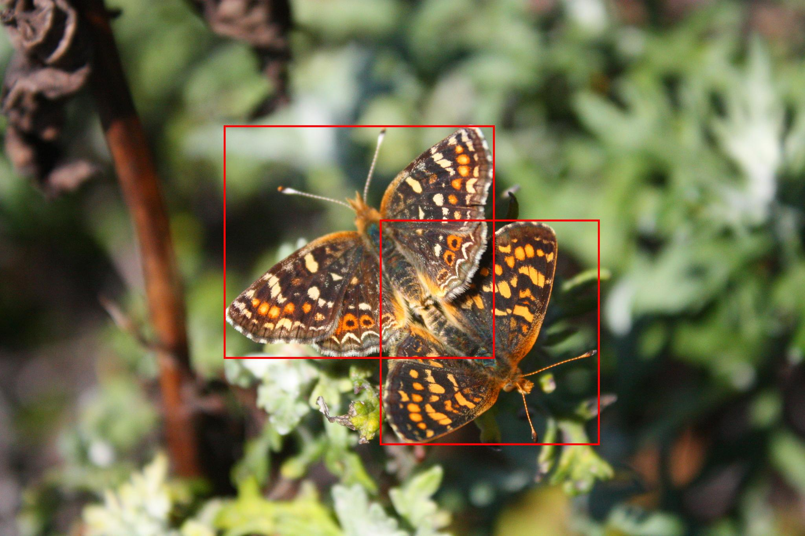
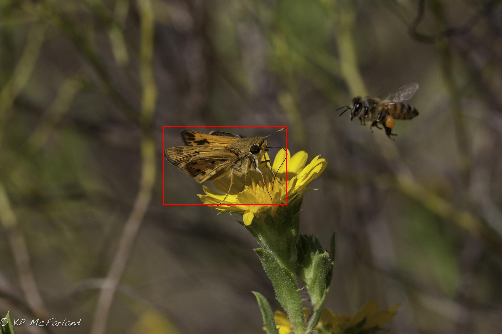
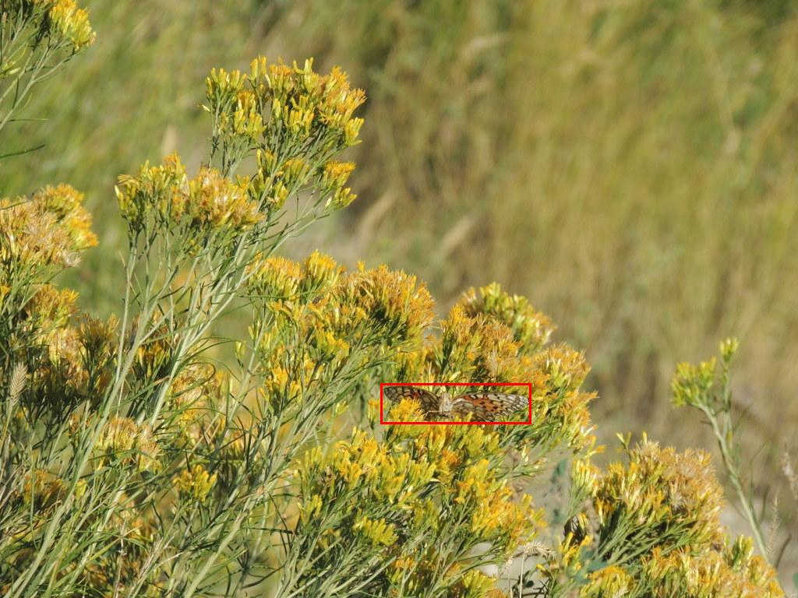
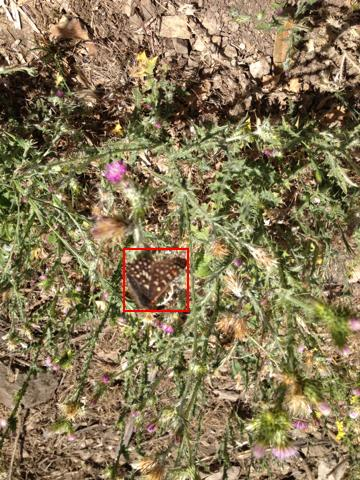

# Модели и эксперименты

Мы запускали три готовые модели локально. GroundingDINO tiny и OWLv2 base ищут объекты по текстовым меткам; Qwen3-VL-2B-Instruct возвращает координаты по инструкции. Версия промпта v1.0 состоит из [описания задачи](project/prompts/qwen.md) и [правил формата ответа](project/prompts/qwen_rules.md).

## Сравнение на командном эталоне

Все прогоны использовали один список из 400 фотографий. Скрипт сопоставляет рамки по убыванию IoU, каждую рамку учитывает один раз. Precision, recall и F1 рассчитаны по суммарным TP, FP и FN успешно обработанных фото при IoU ≥ 0,5. Время измеряли на MacBook M4 Pro с 48 ГБ памяти.

| Модель / конфигурация | Порог уверенности | Успешных изображений | Precision | Recall | F1 | Mean matched IoU | Среднее время, с/изображение |
|---|---:|---:|---:|---:|---:|---:|---:|
| DINO — butterfly + moth | 0.10 | 400/400 | 14.4% | 89.4% | 24.8% | 0.889 | 0.72 |
| DINO — только butterfly | 0.15 | 400/400 | 62.9% | 67.1% | 65.0% | 0.874 | 0.37 |
| DINO — только butterfly | 0.30 | 400/400 | 100.0% | 1.1% | 2.1% | 0.976 | 0.37 |
| DINO — описательные метки | 0.30 | 400/400 | 40.0% | 4.2% | 7.7% | 0.928 | 1.83 |
| OWLv2 — butterfly + moth | 0.10 | 400/400 | 8.4% | **97.2%** | 15.5% | 0.835 | 0.53 |
| OWLv2 — только butterfly | 0.30 | 400/400 | 70.2% | 88.3% | 78.2% | 0.827 | 0.27 |
| **OWLv2 — только butterfly** | **0.40** | **400/400** | **83.5%** | **82.3%** | **82.9%** | 0.824 | **0.27** |
| Qwen — промпт v0.1 | — | 400/400 | 67.6% | 88.3% | 76.6% | 0.883 | 5.67 |
| Qwen — промпт v0.2 | — | 399/400 | 80.1% | 93.6% | 86.3% | 0.883 | 6.00 |
| **Qwen — промпт v1.0** | — | **399/400** | **91.6%** | **92.9%** | **92.3%** | **0.885** | 6.29 |

Для OWLv2 при запросе `butterfly` повышение порога с 0,30 до 0,40 увеличило precision с 70,2% до 83,5%. Recall снизился с 88,3% до 82,3%, но F1 вырос с 78,2% до 82,9%. Qwen с промптом v1.0 дал лучший F1. На фото `762240961` его ответ не удалось преобразовать в JSON, поэтому опубликованная оценка Qwen охватывает 399 фото. [Построчный отчёт Qwen](../data/evaluations/qwen_manual_prompt_recovered.csv)

## Воспроизведение оценки

Выполняйте команды из корня репозитория с установленным `uv`. Версия Python в проекте — 3.11, зависимости зафиксированы в [uv.lock](../uv.lock). При первом запуске потребуются доступ к фотографиям и загрузка весов модели.

```sh
uv sync --locked
uv run materialize -i data/golden_set.json -o data/images/evaluation
uv run evaluate -i data/golden_set.json --images data/images/evaluation -m dino --labels butterfly --score-threshold 0.15 -o runs/dino.csv
uv run evaluate -i data/golden_set.json --images data/images/evaluation -m owl --labels butterfly --score-threshold 0.40 -o runs/owl.csv
uv run evaluate -i data/golden_set.json --images data/images/evaluation -m qwen --prompt src/project/prompts/qwen.md -o runs/qwen.csv
uv run recover-evaluation runs/qwen.csv runs/qwen.responses.jsonl runs/qwen_recovered.csv
```

Команды запускают лучшие конфигурации из таблицы. Для повторения базовых прогонов детекторов из [опубликованных CSV](../data/evaluations/) задайте `--labels butterfly moth --score-threshold 0.10`. Команда `recover-evaluation` разбирает сохранённые ответы Qwen с ошибками формата и записывает исправимую часть в отдельный CSV.

## Предсказания для Контеста

```sh
uv run materialize-dataset -i data/dataset.jsonl -o data/images/prediction
uv run predict -m qwen --images data/images/prediction --prompt src/project/prompts/qwen.md -o runs/qwen_prediction.jsonl
```

Если в ответах Qwen встретился повреждённый JSON, используйте сохранённый журнал попыток. Когда файл предсказаний собран, его можно наложить на изображения для визуальной проверки.

```sh
uv run recover-predictions -i runs/qwen_prediction.attempts.jsonl -o runs/qwen_prediction.jsonl
uv run render-predictions -i runs/qwen_prediction.jsonl --images data/images/prediction -o runs/qwen_results
```

## Примеры предсказаний Qwen

<details>
<summary>Две пересекающиеся бабочки</summary>



</details>

<details>
<summary>Бабочка vs пчела</summary>



</details>

<details>
<summary>Замаскировавшаяся бабочка #1</summary>



</details>

<details>
<summary>Замаскировавшаяся бабочка #2</summary>



</details>
